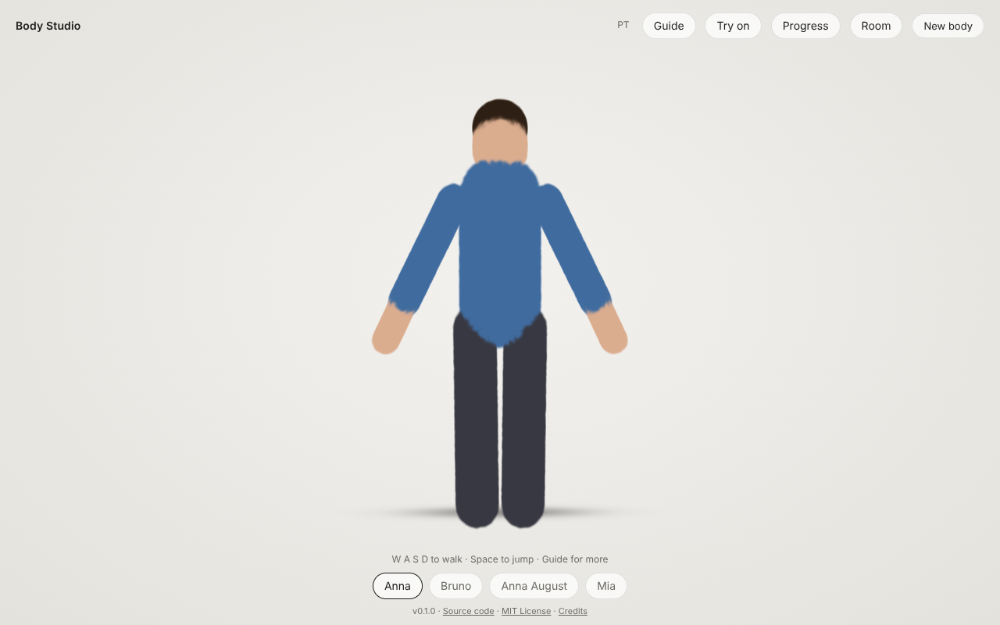
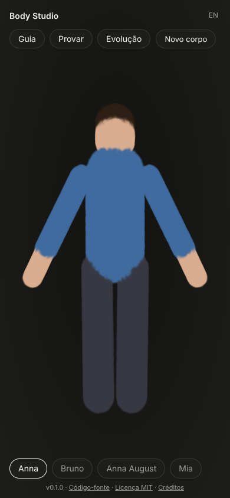
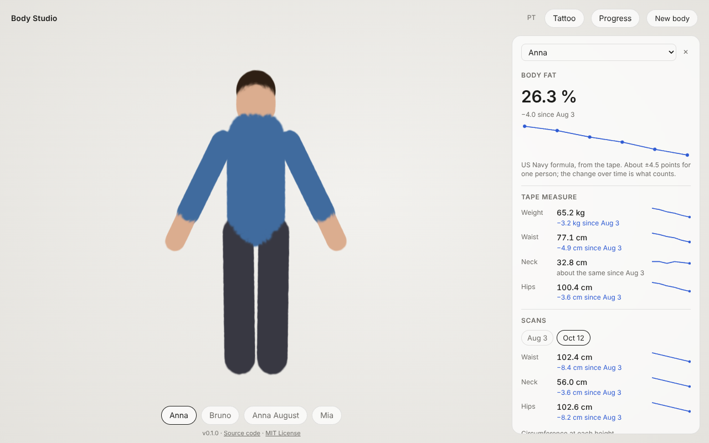
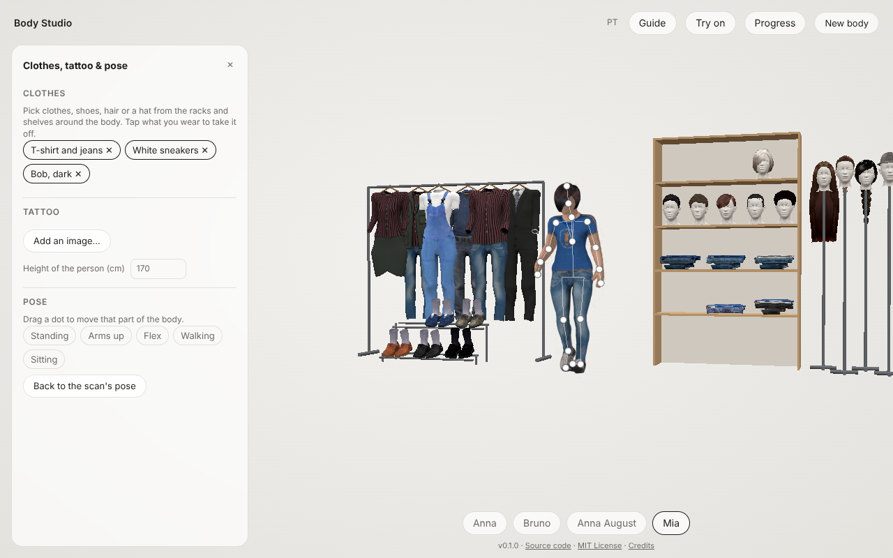
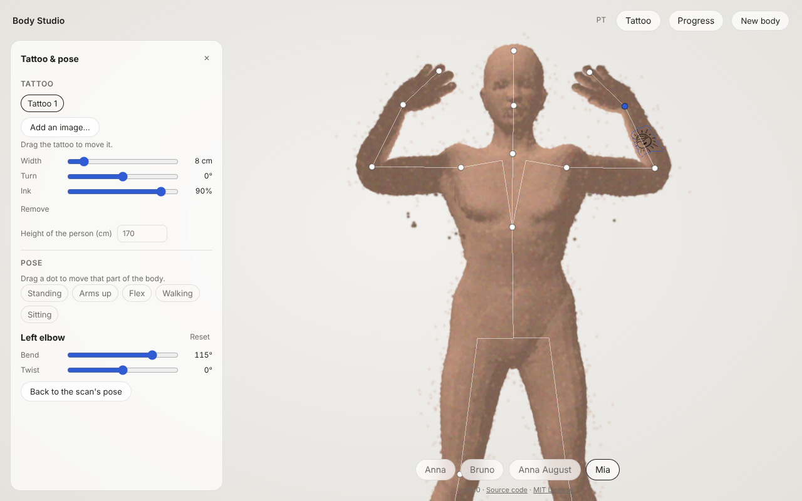
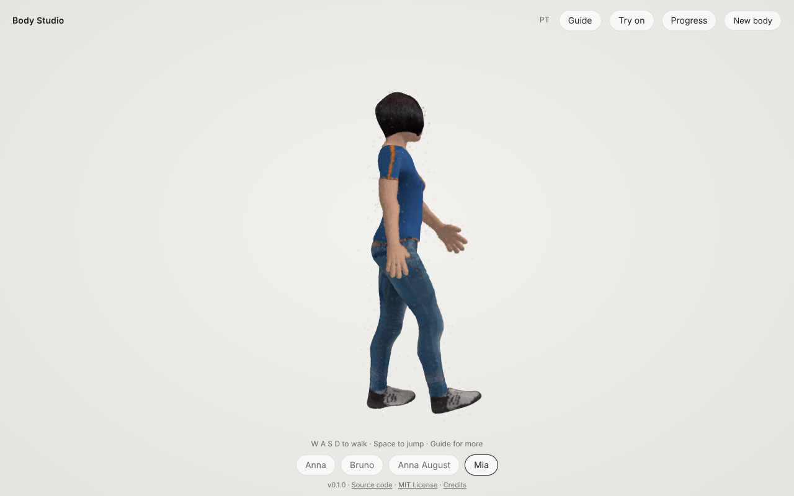
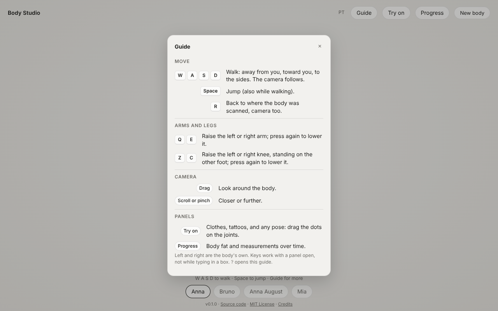
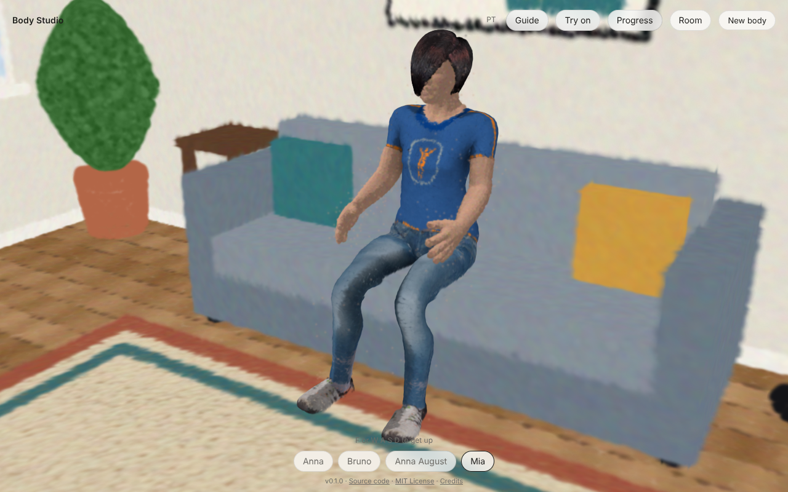
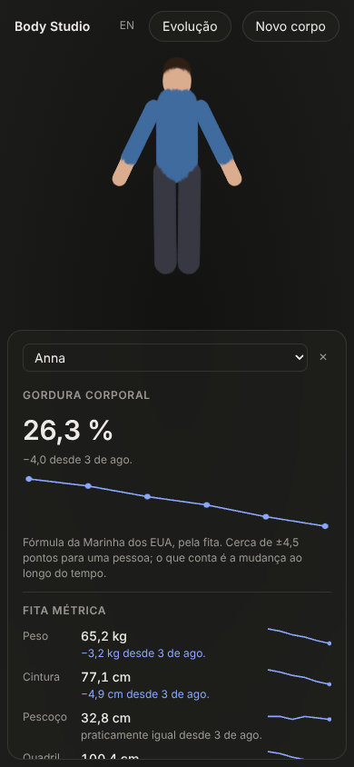
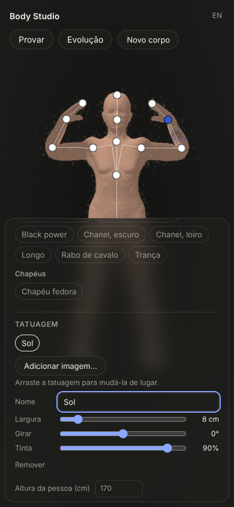

# Body Studio

*English · [Português](#português)*. The app itself switches between English and Portuguese.

**Turn a phone video of a person into a 3D body you can orbit, on your own Mac.**

One screen: the body stands in the middle and turns slowly; drag to look around, pick another
body from the row at the bottom, or drop a new video anywhere on the page.





Everything runs locally: no uploads, no accounts, no cloud GPU. The capture pipeline is
[Splat Studio](https://github.com/gpspelle/splat-studio)'s, installed as a dependency:

| Step | Tool |
|---|---|
| Video → frames | ffmpeg |
| Frames → camera poses | COLMAP |
| Poses → splat | Brush (Metal on Apple Silicon) |
| Fog, floor and room removed | Splat Studio (always on for bodies; a room keeps itself) |
| Runs, time left, advice | Splat Studio's job runner |
| Body on screen | Spark + three.js |

<br clear="right">

## Install

You need a Mac with Apple Silicon and Python 3.9 or newer.

```bash
git clone https://github.com/gpspelle/body-studio.git
cd body-studio
python3 -m venv .venv && source .venv/bin/activate
pip install -e .
body-studio setup        # installs ffmpeg, COLMAP, builds Brush, and PyTorch and Anny, once (10–30 min)
body-studio              # opens http://localhost:8770
```

`pip install -e .` also installs OpenCV, which drops blurry frames. `body-studio check` shows what's installed. Videos and bodies are kept in `~/BodyStudio`
(change it with `--data-dir`), in the same layout Splat Studio uses.

## Filming a person

- The person stands **still** in an A-pose: feet shoulder-width apart, arms a little away from the body.
  Any movement during the take blurs that part of the body.
- Walk around them **three times**: at knee height, at chest height, and holding the phone above their head.
  1½–3 minutes in total, one continuous take, on the 1× lens.
- **Soft, even light** and a background with some texture (not a plain white wall). Lock focus and exposure.
- **Long hair tied back** (a bun or a ponytail), so the head and neck keep their shape. Hair tried on in the
  app is drawn over the head, and it can't hide hair that was filmed loose over the shoulders.

## Command line

```bash
body-studio run IMG_1234.MOV                     # whole pipeline in the terminal
body-studio run IMG_1234.MOV --quality preview   # quick look
body-studio run IMG_1234.MOV --start 0:03 --end 2:10
body-studio room LIVING_ROOM.MOV                 # a room filmed from inside, for the body to stand in
```

The finished body is `workspace/<video>/run_<date_time>/splat/<quality>_<steps>_object.ply`.
Background removal always runs; the untouched splat and the fog-free copy are kept next to it.
On a Mac (with Apple's Vision) or with SAM 2 installed, the person is also cut out of every
frame before training (splat-studio's `--person`), so nothing of the room is learnt; the masks
are kept in `frames/<video>/masks/`.

While a video is processed, the top bar shows the stage and the time left, measured from the
run itself. If a run fails, it says why in terms of the video (for example, which seconds to film again).

### Measurements and body fat (experimental)

```bash
body-studio measure workspace/<video>/run_<date_time>/splat/standard_30000_object.ply \
    --sex m --height 178 --weight 80 --tape-waist 86
```

Prints neck, waist (at the navel) and hip circumferences, measured on the body like a tape, and
a body fat estimate from the US Navy, US Army one-site and relative fat mass equations.
`--height` is required: it gives the body its real size. `--weight` adds the Army equation.
`--tape-waist` (your own tape measure, same day) checks the capture: more than 2 cm apart means
something is off. Film in underwear or tight clothing, waistband below the navel, long hair tied up.
Expect about ±4.5 points of body fat for one person; it is best for following the same person
over time. Research and sources: [docs/body-fat.md](docs/body-fat.md).

## Following a person over time

Click **Progress** to follow one person: a tape measure every week or two, a scan now and then.
The body stays in the middle; the panel sits at the right edge (at the bottom on a phone).



- **Body fat**, from the tape measures, with its trend. One formula for the whole series (US Navy
  when neck and waist are there, and hips for women), so a change in the number is a change in
  the body. It is about ±4.5 points off for one person; the change over time is what counts.
- **Tape measures**: weight, waist, neck and hips, each with its latest value, the change since
  the first entry and a small line of every entry. A change smaller than the measurement noise
  (1 kg, 1 cm, 0.5 cm at the neck) reads "about the same", in grey.
- **Scans**: add the body on screen to the person's history (dated by its run). Each scan is
  measured once, with the person's height, and the panel draws the circumference at every
  height of the body on screen over the first scan, with the change at the neck, waist and hips.
  Tap a date to show that body.

The same from the terminal:

```bash
body-studio person Anna --sex f --height 168
body-studio tape Anna --waist 74 --neck 32 --hip 98 --weight 61     # today; --date 2026-10-01 for another day
body-studio scan Anna Anna_front/run_20261012_120000
body-studio progress Anna
```

Each person is one file, `people/<name>.json` in the data folder. How the design was chosen:
[docs/progress.md](docs/progress.md).

## Clothes, tattoo & pose

Click **Try on** to dress the body, try a tattoo on it and move it to see how it all sits. The
panel sits at the left edge (at the bottom on a phone).





- **Clothes**: while the panel is open, a small shop stands around the body: outfits on hangers
  on a clothes rail, shoes on a shoe rack, folded T-shirts and jeans on shelves with short hair on
  mannequin heads above them, and long hair and the fedora on stands. Point at an item to see its
  name, click it to put it on. There are 12 outfits, 6 pairs of shoes, 10 hairstyles and a
  fedora. Each is fitted to this person's shape, moves with the pose, and hides the skin under
  it. What is worn stays in its place on the rack as a pale outline and is listed in the panel:
  click the outline (or its ✕ in the panel) to take it off, or **Take everything off**. What
  is worn is kept in this browser, per body. The first time, the app fits a model body to the
  scan (a few seconds): it takes the person's build first (MakeHuman's own body-shape sliders,
  set to match the scan), then their exact surface, so clothes sit closer.
  All of them are MakeHuman's own assets, free to use (CC0): see [CREDITS.md](CREDITS.md).

- **Add an image** (PNG, JPG, WebP, SVG), then tap the body where it goes. Drag it to move it;
  set its width in centimetres, its turn and how strong the ink is, and give it a name to tell
  it apart from the others. Designs drawn on white have
  the white removed. The tattoo follows the skin wherever you put it: around an arm, across the
  back, over a shoulder, from the lower back onto both thighs. It is drawn into the skin as
  ink, so the skin shows through it, and whatever covers the skin (an arm, clothes) covers it.
- **Move the body**: drag the dot on a joint (the elbow dot turns the shoulder, the wrist dot
  the elbow…), or pick a pose: standing, arms up, flex, walking, sitting. Each joint only moves
  the way a person's can, within its normal range: an arm reaches across the chest or back behind,
  a bent knee turns the shin, the wrist bends toward the palm and to the sides and the forearm turns
  the hand. An arm stops at the body instead of going into it. Pick a joint to set its angles with
  sliders.
  The tattoo moves with the skin.
- **Walk it around**: press **W A S D** (or the arrow keys) and the body walks across the floor,
  away from you, toward you or to the sides, turning to face the way it goes; the camera follows
  at an even pace, without bobbing with each step.
  **Space** jumps. **Q** / **E** raise the left / right arm and **Z** / **C** the left / right
  knee (the body's own left and right); they stay up until pressed again. Clothes, hair, shoes and
  tattoos go along. Let go and it stands where it got to, in the pose from the panel, with arms
  that were held out as in the scan now down by its sides; **R** brings it back. The first press
  finds the skeleton if the panel hasn't yet. **Guide** (or **?**) lists every control.

  

  
- **It looks alive**: standing still, the body breathes, sways a little, blinks and turns its head
  to you. Walking, its feet stay planted. Skin darkens where it meets skin, the biceps swells as
  the arm bends, a skirt or a ponytail trails behind as it walks and turns and swings on when it
  stops, and a soft shadow on the floor follows it. Pick
  **Hands**: as scanned, relaxed or a fist. **What if** sliders show the person lighter or heavier
  (about ±12 kg) and with less or more muscle; they aren't saved. How it works:
  [docs/flesh.md](docs/flesh.md).
- The first time, the app finds the body's skeleton (a few seconds). It needs the A-pose from the
  filming guide: arms a little away from the body, feet apart. Tattoos and pose are kept in this
  browser, per body.

`body-studio rig BODY.ply` does the skeleton step in the terminal and prints the joint heights.
It saves `BODY.rig.json` next to the body. How it works, the body models that were considered
and their licences, and the limits: [docs/tattoo.md](docs/tattoo.md).

`body-studio fit BODY.ply` does the clothes fitting step in the terminal and saves `BODY.fit.json`
next to the body. How the clothes are fitted and drawn, where they come from, and the limits:
[docs/wardrobe.md](docs/wardrobe.md).

Trial: the Try on panel shows **Body model: Standard / Anny (trial)**, to see the same clothes on a
body fitted either way ([Anny](https://github.com/naver/anny) is a body model that runs on PyTorch).
`body-studio setup` installs PyTorch and Anny; if they aren't there, the first click on Anny installs
them, with nothing to type (a few minutes, once). The Anny fit takes about two minutes the first time
per body and is saved as `BODY.anny.fit.json`; `body-studio fit-anny BODY.ply` makes it in the
terminal. PyTorch is only needed for this. Results so far: [docs/anny.md](docs/anny.md).

## A room around the body

Film a room, or your whole house, from inside it, and the body stands in it: to its own scale, on
its floor. Walk it round with **W A S D**: walls and furniture stop it (it slides along them).
Press **F** next to the sofa or a chair to sit down, or next to a wall to lean on it; **F** again
gets up. The camera stays inside the room.



- **Room** at the top opens the list of rooms filmed so far. **Add a room…** takes its video (an
  iPhone capture from Splat Capture works too, and is in metres). Pick a room to put the body in
  it, **No room** to take it out. **Size** corrects the room's size if it looks off.
- **Sample living room** is always in the list, so you can try it before filming anything: a
  furnished room drawn by the app (sofa, armchair, bookshelf, TV, dining table, plant), made in
  the data folder the first time the list opens (`workspace/_sample_room/`).
- Filming a room: walk slowly round it with the phone at chest height, pointing at the walls, and
  get the floor (and the ceiling, if you can) in view. One take, 1–3 minutes; for a house, walk
  from room to room without stopping.
- A room's run keeps the room: no background removal (splat-studio's `--scene`, where only the fog
  in the air is removed). Its name is kept in `rooms.json` in the data folder, so it is listed as a
  room, not a body. The first time, the app maps it (a few seconds): the floor, the size (from the
  height the phone was held at), the walls, the furniture and the seats; it saves
  `NAME_clean.room.json` next to it. `body-studio room-map ROOM.ply` does it in the terminal.

How it works and the limits (flat floors only, the size is a guess within about 10%):
[docs/room.md](docs/room.md).

## Development

```bash
pip install -e .
python -m unittest discover -s tests/unit -t .

# end to end: the real splat-studio pipeline with its stand-in COLMAP and Brush (needs ffmpeg)
export SPLAT_STUDIO_SRC="$(python3 scripts/splat_studio_src.py)"
python -m unittest tests.integration.test_end_to_end

pip install playwright && python -m playwright install chromium
python -m unittest tests.browser.test_viewer        # the app in a real browser
python3 scripts/screenshots.py                      # regenerates docs/images/
```

See [AGENTS.md](AGENTS.md) for conventions and [docs/plan.md](docs/plan.md) for what comes next.

---

## Português

**Transforme um vídeo de uma pessoa, feito no celular, em um corpo 3D que você pode girar, no seu próprio Mac.**

Uma tela só: o corpo fica no centro e gira devagar. Arraste para olhar em volta, escolha outro
corpo na fileira de baixo ou solte um vídeo novo em qualquer lugar da página. Tudo roda no seu
computador, sem upload, sem conta e sem GPU na nuvem. O processamento é o do
[Splat Studio](https://github.com/gpspelle/splat-studio), instalado como dependência. A remoção
do fundo, do chão e da névoa sempre acontece.

### Instalar

```bash
git clone https://github.com/gpspelle/body-studio.git
cd body-studio
python3 -m venv .venv && source .venv/bin/activate
pip install -e .
body-studio setup        # instala ffmpeg, COLMAP, compila o Brush e instala PyTorch e Anny, uma vez (10 a 30 min)
body-studio              # abre http://localhost:8770
```

`pip install -e .` também instala o OpenCV, que descarta os quadros borrados.

### Filmar uma pessoa

- A pessoa fica **parada** em pose A: pés afastados na largura dos ombros, braços um pouco afastados do corpo.
- Dê **três voltas** ao redor dela: na altura do joelho, na altura do peito e com o celular acima da cabeça.
  De 1½ a 3 minutos no total, em uma única tomada, na lente 1×.
- **Luz suave e uniforme** e um fundo com alguma textura (não uma parede branca lisa). Trave o foco e a exposição.
- **Cabelo comprido preso** (coque ou rabo de cavalo), para a cabeça e o pescoço manterem a forma. O cabelo
  que você prova no app é desenhado sobre a cabeça e não esconde um cabelo filmado solto sobre os ombros.

### Linha de comando

```bash
body-studio run IMG_1234.MOV
body-studio run IMG_1234.MOV --quality preview
body-studio room SALA.MOV                        # um cômodo filmado por dentro, para o corpo ficar nele
```

O corpo pronto fica em `workspace/<vídeo>/run_<data_hora>/splat/<qualidade>_<passos>_object.ply`.
Num Mac (com o Vision da Apple) ou com o SAM 2 instalado, a pessoa também é recortada de cada
quadro antes do treino (o `--person` do splat-studio), então nada da sala é aprendido; as máscaras
ficam em `frames/<vídeo>/masks/`.

### Acompanhar uma pessoa ao longo do tempo

Clique em **Evolução** para acompanhar uma pessoa: fita métrica a cada uma ou duas semanas, um
escaneamento de vez em quando. O corpo continua no centro; o painel fica na borda direita (embaixo,
no celular).



- **Gordura corporal**, pela fita métrica, com a tendência. Uma só fórmula para a série inteira
  (Marinha dos EUA quando há pescoço e cintura, e quadril para mulheres), então uma mudança no
  número é uma mudança no corpo. Erra cerca de ±4,5 pontos para uma pessoa; o que conta é a mudança.
- **Fita métrica**: peso, cintura, pescoço e quadril, cada um com o último valor, a mudança desde
  a primeira medida e uma pequena linha com todas as medidas. Uma mudança menor que o ruído da
  medida (1 kg, 1 cm, 0,5 cm no pescoço) aparece como "praticamente igual", em cinza.
- **Escaneamentos**: adicione o corpo na tela ao histórico da pessoa (com a data da execução). Cada
  um é medido uma vez, com a altura da pessoa, e o painel desenha a circunferência em cada altura
  do corpo na tela sobre a do primeiro escaneamento, com a mudança no pescoço, na cintura e no quadril.

No terminal: `body-studio person`, `tape`, `scan` e `progress` (exemplos acima, em inglês). Cada
pessoa é um arquivo, `people/<nome>.json` na pasta de dados.

### Roupas, tatuagem e pose

Clique em **Provar** para vestir o corpo, testar uma tatuagem e mexer o corpo para ver como tudo
fica. O painel fica na borda esquerda (embaixo, no celular).



- **Roupas**: com o painel aberto, uma pequena loja fica em volta do corpo: looks em cabides numa
  arara, sapatos numa sapateira, camisetas e jeans dobrados em prateleiras com cabelos curtos em
  cabeças de manequim acima, e cabelos compridos e o chapéu fedora em pedestais. Aponte para uma
  peça para ver o nome e clique para vestir. São 12 looks, 6 pares de sapatos, 10 cortes de cabelo
  e um chapéu fedora. Cada peça se ajusta ao corpo da pessoa, acompanha a pose e esconde a pele
  embaixo dela. O que está vestido fica no lugar dele na arara como um contorno claro e aparece no painel:
  clique no contorno (ou no ✕ no painel) para tirar, ou em **Tirar tudo**. O que
  está vestido fica guardado neste navegador, para cada corpo. Na primeira vez, o app
  ajusta um corpo modelo ao escaneado (alguns segundos): primeiro o tipo físico da pessoa (os
  próprios controles de forma do corpo do MakeHuman, ajustados ao escaneado), depois a superfície
  exata, para as roupas ficarem mais justas. Todas são peças do próprio MakeHuman, de
  uso livre (CC0): veja [CREDITS.md](CREDITS.md).

- **Adicione uma imagem** (PNG, JPG, WebP, SVG) e toque no corpo onde ela vai. Arraste para mudar
  de lugar; ajuste a largura em centímetros, o giro e a força da tinta, e dê um nome para
  diferenciá-la das outras. Desenhos sobre fundo branco
  perdem o branco. A tatuagem acompanha a pele onde você a colocar: em volta do braço, nas costas,
  por cima do ombro, da lombar até as duas coxas. Ela é desenhada na pele como tinta,
  então a pele aparece através dela, e o que cobre a pele (um braço, a roupa) cobre a tatuagem.
- **Mexa o corpo**: arraste o ponto de uma articulação (o ponto do cotovelo gira o ombro, o do
  pulso gira o cotovelo…) ou escolha uma pose: em pé, braços para cima, bíceps, andando, sentado.
  Cada articulação só se move como a de uma pessoa, dentro da amplitude normal: o braço cruza
  na frente do peito ou vai para trás, o joelho dobrado gira a canela, o pulso dobra para a palma
  e para os lados e o antebraço gira a mão. O braço para no corpo em vez de entrar nele. Escolha uma
  articulação para ajustar os ângulos com controles deslizantes. A tatuagem acompanha a pele.
- **Saia andando**: aperte **W A S D** (ou as setas) e o corpo anda pelo chão, para longe de você,
  na sua direção ou para os lados, virando para onde vai; a câmera acompanha em ritmo constante (sem
  balançar a cada passo). **Espaço** pula.
  **Q** / **E** levantam o braço esquerdo / direito e **Z** / **C** o joelho esquerdo / direito (a
  esquerda e a direita do próprio corpo); ficam levantados até você apertar de novo. Roupas, cabelo,
  sapatos e tatuagens vão junto. Solte e ele fica onde chegou, na pose do painel, com os braços que
  estavam abertos como no escaneamento agora abaixados ao lado do corpo; **R** o traz de volta. O
  primeiro toque encontra o esqueleto, se o painel ainda não encontrou. **Guia** (ou **?**) mostra
  todos os controles.
- **Parece vivo**: parado, o corpo respira, balança um pouco, pisca e vira a cabeça para você.
  Andando, os pés ficam firmes no chão. A pele escurece onde encosta em pele, o bíceps cresce
  quando o braço dobra, a saia ou o rabo de cavalo ficam um pouco para trás ao andar e virar e
  balançam quando ele para, e uma sombra suave no chão acompanha
  o corpo. Escolha **Mãos**: como escaneadas, relaxadas ou punho fechado. Os controles **E se**
  mostram a pessoa mais leve ou mais pesada (cerca de ±12 kg) e com menos ou mais músculo; não são
  salvos. Como funciona (em inglês): [docs/flesh.md](docs/flesh.md).
- Na primeira vez, o app encontra o esqueleto do corpo (alguns segundos). Precisa da pose A do guia
  de filmagem: braços um pouco afastados do corpo, pés afastados. Tatuagens e pose ficam guardadas
  neste navegador, para cada corpo.

`body-studio rig CORPO.ply` faz o esqueleto no terminal e salva `CORPO.rig.json` ao lado do corpo.
Como funciona, os modelos de corpo considerados e suas licenças, e os limites (em inglês):
[docs/tattoo.md](docs/tattoo.md).

`body-studio fit CORPO.ply` faz o ajuste das roupas no terminal e salva `CORPO.fit.json` ao lado do
corpo. Como as roupas são ajustadas e desenhadas, de onde vêm e os limites (em inglês):
[docs/wardrobe.md](docs/wardrobe.md).

Teste: o painel Provar mostra **Modelo de corpo: Padrão / Anny (teste)**, para ver as mesmas roupas
num corpo ajustado de um jeito ou de outro (o [Anny](https://github.com/naver/anny) é um modelo de
corpo que roda no PyTorch). O `body-studio setup` instala o PyTorch e o Anny; se não estiverem lá, o
primeiro clique em Anny os instala, sem nada para digitar (alguns minutos, uma vez). O ajuste com o Anny leva cerca de dois
minutos na primeira vez para cada corpo e fica salvo como `CORPO.anny.fit.json`;
`body-studio fit-anny CORPO.ply` faz o mesmo no terminal. O PyTorch só é preciso para isso.
Resultados até agora (em inglês): [docs/anny.md](docs/anny.md).

### Um cômodo em volta do corpo

Filme um cômodo, ou a casa toda, por dentro, e o corpo fica nele: na escala certa, no chão dele.
Ande com **W A S D**: as paredes e os móveis o param (ele desliza ao longo deles). Aperte **F**
perto do sofá ou de uma cadeira para sentar, ou perto de uma parede para se encostar; **F** de novo
levanta. A câmera fica dentro do cômodo.

- **Cômodo**, no alto, abre a lista dos cômodos já filmados. **Adicionar um cômodo…** recebe o
  vídeo (uma captura do iPhone feita no Splat Capture também serve, e já vem em metros). Escolha um
  cômodo para colocar o corpo nele, **Nenhum** para tirar. **Tamanho** corrige o tamanho do cômodo
  se parecer errado.
- **Sala de exemplo** está sempre na lista, para experimentar antes de filmar qualquer coisa: uma
  sala mobiliada desenhada pelo app (sofá, poltrona, estante, TV, mesa de jantar, planta), criada
  na pasta de dados na primeira vez que a lista abre (`workspace/_sample_room/`).
- Para filmar um cômodo: ande devagar em volta, com o celular na altura do peito, apontando para as
  paredes, e pegue o chão (e o teto, se der). Uma tomada só, de 1 a 3 minutos; para a casa, vá de
  um cômodo ao outro sem parar.
- A execução de um cômodo mantém o cômodo: sem remover o fundo (o `--scene` do splat-studio, que
  tira só a névoa no ar). O nome fica em `rooms.json` na pasta de dados, para ele aparecer como
  cômodo e não como corpo. Na primeira vez, o app faz o mapa (alguns segundos): o chão, o tamanho
  (pela altura em que o celular foi segurado), as paredes, os móveis e os assentos; salva
  `NOME_clean.room.json` ao lado. `body-studio room-map COMODO.ply` faz isso no terminal.

Como funciona e os limites (só chão plano, o tamanho é uma estimativa com cerca de 10% de erro), em
inglês: [docs/room.md](docs/room.md).

### Medidas e gordura corporal (experimental)

```bash
body-studio measure workspace/<vídeo>/run_<data_hora>/splat/standard_30000_object.ply \
    --sex m --height 178 --weight 80 --tape-waist 86
```

Mostra as circunferências do pescoço, da cintura (na altura do umbigo) e do quadril, medidas no
corpo como uma fita métrica, e uma estimativa de gordura corporal pelas equações da Marinha dos
EUA, do Exército dos EUA (um ponto) e da massa gorda relativa. `--height` é obrigatório: dá ao
corpo o tamanho real. `--weight` acrescenta a equação do Exército. `--tape-waist` (sua própria
fita métrica, no mesmo dia) confere a captura: mais de 2 cm de diferença indica um problema.
Filme de roupa íntima ou roupa justa, com o elástico abaixo do umbigo e o cabelo comprido preso.
Espere cerca de ±4,5 pontos de gordura corporal para uma pessoa; serve melhor para acompanhar a
mesma pessoa ao longo do tempo. Pesquisa e fontes (em inglês): [docs/body-fat.md](docs/body-fat.md).
