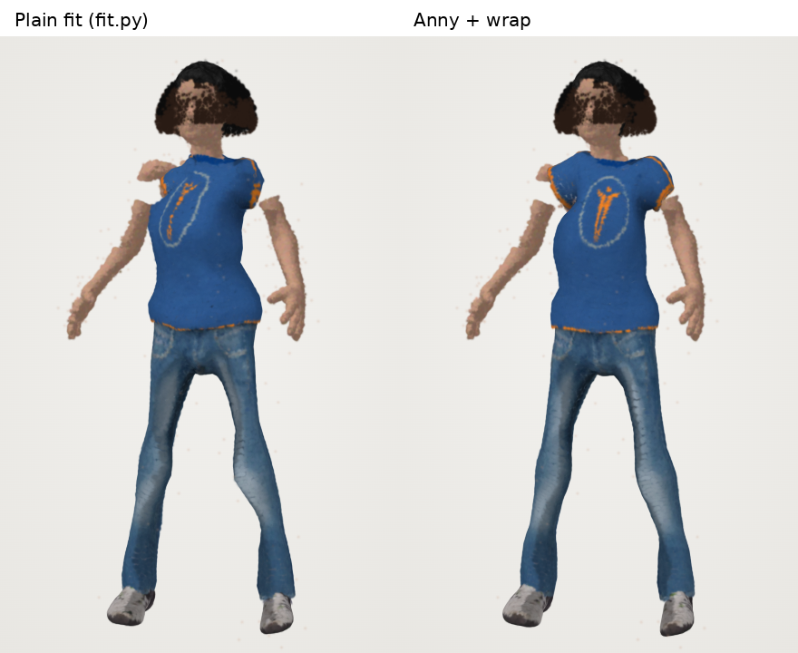
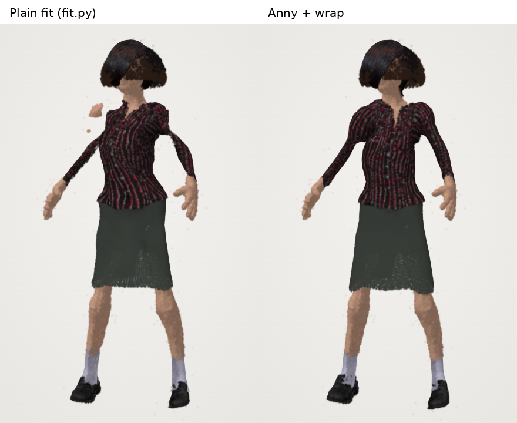

# Trial: fitting the clothes' body with Anny (PyTorch)

A side-by-side trial of two ways to lay MakeHuman's base mesh (the body every garment is made
for) on a scan, before deciding which to keep:

- **Plain** (`body-studio fit`, `fit.py`, the default): MakeHuman's own shape targets solved by
  least squares, the bones bent onto the scan's skeleton, then a shrinkwrap onto the splats.
  Standard library only. See [wardrobe.md](wardrobe.md).
- **Anny** (`body-studio fit-anny`, `anny_fit.py`, optional): [Anny](https://github.com/naver/anny)
  by NAVER LABS, MakeHuman as a differentiable PyTorch model (code Apache-2.0, MakeHuman data
  CC0). Its "makehuman" topology is the base mesh vertex for vertex, so every garment keeps its
  binding with no change.

## Trying it

```bash
pip install 'body-studio[anny]'          # PyTorch and Anny, about 5 GB with PyTorch's CUDA libraries
body-studio ui
```

With Anny installed, the **Try on** panel shows **Body model: Standard / Anny (trial)** under the
clothes. Pick one and what is worn comes off and goes on again, fitted to that model. The choice
is kept in the browser. The first time a body is fitted with Anny it takes about two minutes on
four CPU cores (and the very first time a minute more, to build Anny's cache in `~/.cache/anny`);
after that it is saved next to the body as `BODY.anny.fit.json`, beside the standard
`BODY.fit.json`, and switching is instant. Without Anny installed the switch isn't shown.

The same in the terminal:

```bash
body-studio fit-anny BODY.ply            # writes BODY.anny.fit.json (fit.py's format, "model": "anny")
body-studio fit-anny BODY.ply --no-wrap  # Anny's skin alone, without the shrinkwrap's close pass
```

The file keeps Anny's overall sliders under `"shape"`. The standard fit takes 5–10 seconds.

**Why a control on the page:** comparing the two fits on a real scan is the point of the trial, and
the same clothes have to be seen on both, from any angle and in any pose. It is two small buttons
in the Try on panel, shown only when Anny is installed.

## How it fits

1. **Pose.** Each main bone of Anny's skeleton (spine, neck, head, clavicles, shoulders, arms,
   wrists, legs, feet) gets a turn, plus one overall turn, shift and size, found with Adam so
   that the joints the skeleton finder (`rig.py`) finds on the base mesh land on the joints it
   found on the scan. A joint is read off the mesh as a fixed blend of the skin vertices around
   it, so the same joint is read off any shape.
2. **Shape.** Then also the sliders: 11 overall ones (gender, age, muscle, weight, height,
   proportions, cup size, firmness, three for ancestry) and 129 regional ones (waist, hips, bust,
   thighs, upper arm fat, neck…). The face and finger sliders are left at zero: a scan can't tell
   them apart. The fit puts the skin on the splats both ways (each skin vertex near a splat, each
   splat near the skin, 3 000 and 6 000 of them drawn afresh each step), with a robust loss whose
   width narrows from 10% to 2% of the height, so skin that starts far off (a bust, a belly) is
   still pulled in while stray splats and hair end up ignored.
3. **Gender, both ways.** From the middle, the fit stays between a male and a female trunk. So it
   is run a short way from each side, and the one closer to the splats goes on.
4. **Wrap**: the plain fit's close shrinkwrap pass (2.5% of the height) on top, for what the
   sliders can't reach (`--no-wrap` leaves it out).
5. **Helpers.** The helper geometry clothes and hair hang from (tights, skirt, hair cap) follows
   the skin under it, as in the plain fit. Anny moves its own helpers too, but not with its
   shape: they ended up as much as 2% of the height (3.5 cm) nearer or further from the skin
   they hang from than on the base mesh, which moves a skirt or tights by as much.
   `test_clothes_stay_outside_the_skin` checks that no more of an outfit sinks under the skin
   than on the plain fit.

Each vertex's turn, which the clothes' offsets follow, comes from the same bone transforms as in
the plain fit, so the two differ only in where the skin is.

## Results

The MakeHuman test body (`tests/fakes/makehuman.py`) in two shapes: a heavy man turned 25° and a
slim woman with her arms 20° lower. Each shape is also used **with holes and hair**, like a real
capture: no splats under the arms or at the crotch, 12% of the body missing in 6 cm patches, and
8 000 splats of hair 1–5 cm out over the head. The distance from each fitted skin vertex to the
true skin, in centimetres ("back" is the other way: from the true skin to the fitted one, so a
part of the body the fit misses shows there). Plain is `fit.py` v3, with the shape solve.

| Body | Fit | Median | 90% | 99% | Back, 99% | Time |
|---|---|---|---|---|---|---|
| heavy man | plain | **0.31** | **0.70** | **1.13** | **1.17** | 11 s |
| | Anny | 0.37 | 1.20 | 2.27 | 2.12 | 116 s |
| | Anny + wrap | 0.38 | 1.06 | 1.78 | 1.64 | 115 s |
| slim woman | plain | **0.33** | **0.73** | **1.31** | **1.50** | 6 s |
| | Anny | 0.48 | 1.24 | 1.96 | 1.95 | 115 s |
| | Anny + wrap | 0.39 | 1.00 | 1.64 | 1.61 | 108 s |
| heavy man, holes and hair | plain | **0.39** | **1.09** | 2.54 | 2.54 | 5 s |
| | Anny | 0.49 | 1.49 | 2.55 | 2.70 | 117 s |
| | Anny + wrap | 0.44 | 1.15 | **1.95** | **1.94** | 116 s |
| slim woman, holes and hair | plain | 0.49 | 1.24 | 2.78 | 3.67 | 5 s |
| | Anny | 0.59 | 1.64 | 3.44 | 3.45 | 119 s |
| | Anny + wrap | **0.48** | **1.23** | **2.49** | **3.02** | 119 s |

- **On a clean body the plain fit wins.** No surprise: the test body *is* MakeHuman's base mesh
  with MakeHuman's targets, the very ones the plain fit solves for, and its shrinkwrap has a
  splat under every vertex.
- **Where the capture has holes and hair, Anny + wrap is better at the worst places**: the 99th
  percentile drops from 2.5 to 1.9 cm (heavy) and 2.8 to 2.5 cm (slim), and the most-missed true
  skin from 3.7 to 3.0 cm. That's under the arms, at the crotch and over the gaps, where the
  shrinkwrap has nothing to land on and only smooths, and Anny's sliders keep a human shape.
- **Anny alone is never the best.** The sliders can't reach every bump, and a tight outfit sinks
  into its skin (on the heavy man, 12% of an outfit more than 1 cm under the true skin, against
  3% on the plain fit). The wrap pass is what makes it competitive, so it is on by default.
- **It costs 10–20 times the time and a 5 GB install.** The plain fit is standard library and
  runs in the app on first use; Anny would have to stay an optional step.

The test bodies are MakeHuman shapes, which flatters both fits. A real scan (clothes, hair,
fog, uneven density) is the test that decides: run both on the same body and put the same
clothes on.

### With clothes on

The slim woman with holes and hair, in the page, plain fit on the left and Anny + wrap on the
right. Where the capture has nothing under her arms, the plain fit's shrinkwrap leaves the
shoulders uneven: the left sleeve breaks and a piece of skin floats off the shoulder, the right
shoulder is pinched, and the jeans bunch at the crotch. On Anny's shape the sleeves and the
shoulders come out whole. On the heavy man the two look the same.




## Limits of the trial

- CPU only here. On a GPU it would be seconds, but the Mac app has none to count on (PyTorch's
  `mps` was not tried).
- The gender slider picks a side by a short fit from each; a body between the two may land on
  the other side, with the regional sliders making up most of the difference.
- Anny pulls in PyTorch (CUDA libraries included on Linux) and NVIDIA Warp; that's why it is an
  extra, and why the app does not use it on its own.
