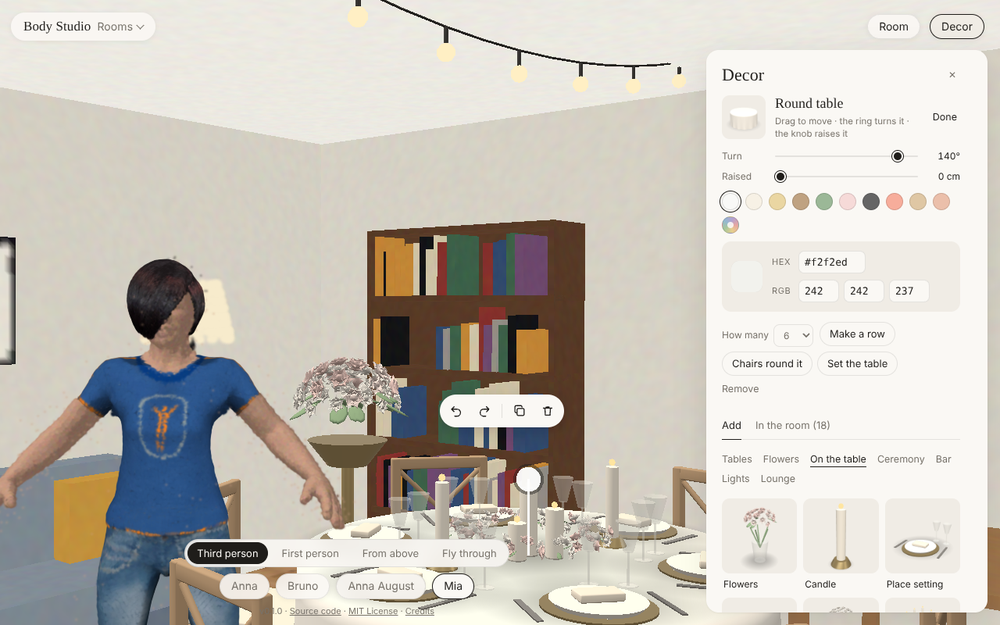

# Decor in a room

Put things round the body in a scanned room: chairs, tables, a flower arch, candles, and things
made in 3D from a photo (an Instagram picture of a centrepiece, a shop's photo of a chair). The
first use is planning a wedding venue: the venue is filmed as a room, the decor is placed in it,
and the body can walk the aisle and sit at the tables.



## The panel

**Decor** appears in the top bar in the Rooms mode (the Body Studio menu), with a room round the
body. It opens a panel at the right edge; the body's own panel and its joints step aside while it is open, and come
back when it is closed. The panel has the picked thing on top, then two tabs, **Add** and **In the
room**:

- **Compare with video**, at the top of the panel: line the room up with a video of the real place
  and tag what it gets wrong ([compare.md](compare.md)).
- **Things**, a catalogue of pictures by kind (Tables, On the table, Ceremony, Bar, Lights, Lounge,
  and From photos once there is one; the kind shown is remembered). Tap one to put it in the room, on
  the floor in view beside the body (flowers, candles: on the table there), turned to face the
  camera.
- **Add from a photo…**: pick a photo, give it a name and its **real height** in centimetres (the
  photo can't tell its size), **Make it in 3D**. It shows as "making…" until it is ready, a minute
  or two later; a thing that failed says why, and a tap tries again.
- **The thing picked** (tap it in the room, or the one just added): drag it along the floor, **Turn**
  (or `[` and `]`), a **colour** for the starters (the last swatch is your own: a colour picker
  with **HEX** and **RGB** fields; a whole "201, 164, 106" pasted in one field fills the three;
  kept as `#rrggbb`, and a piece in your colour keeps its finish: a brass chair painted blue is
  still metal), its **real height** for a thing made from a
  photo, **Make a row** of 2–12 side by side, **Chairs round it** for a table (round: on a circle,
  facing the middle; long: along both sides, then the ends; the chair last put down, in its
  colour), **Set the table** (a place setting in front of each chair or bench seat at it, just
  inside its edge, facing the guest; a place that is set already is left), **Remove** (or Delete). A thing made
  from a photo can also be deleted from the things.
- **In the room**: everything placed, by kind, numbered within a name (Chair 1, Chair 2...). Tap a
  line to pick it, ✕ to take it away. The tab says how many there are.
- **Handles** on the picked thing, like the body's joints: a ring on the floor round it, with a
  knob where its front faces (drag: turn, in 15° steps, Shift for any angle), and a knob on a stalk
  over it (drag: raise or lower, 0–5 m; **Raised** in the panel does the same). Drag the thing
  itself to move it. The handles are drawn over everything, so the thing never hides them, and
  are found on the screen (within 24 px of a knob, 12 px of the ring), not by what the pointer's
  ray touches; the pointer shows a hand over a thing or the ring's knob, up and down arrows over
  the lift knob, and the knob under it grows. A small
  toolbar floats just above it: turn a step left or right, **Duplicate** (a copy beside it),
  remove.
- **Layout** (in **In the room**): several arrangements per room (**New**, **Copy**, **Delete**),
  kept in the data folder.

Chairs and tables stop the walk like the room's furniture does (an arch only at its posts, so the
body walks through it; a runner, a rug, the dance floor, candles and lanterns are walked over or
past), and **F** sits on a chair, a bench (three places), a sofa (two), an armchair or a bar
stool that was put in the room.

## What games do

How games that are about placing things deal with a long catalogue, finding what is already placed
and editing it, and what we took:

- **The Sims (build and buy mode)**: the catalogue in a bar by room and kind; a picked object
  follows the pointer, turns with keys or a right drag in 45° steps (free with a key held), can be
  raised; the rest of the interface (the Sim's needs, the career) is put away in build mode. Taken:
  the kinds as tabs, turning in steps with free turning held, the body's panel out of the way.
- **Animal Crossing: New Horizons (decorating mode)**: a separate mode with its own simple
  controls; pick a thing, then move, turn, put it away; a storage list of what is not placed.
  Taken: one panel at a time, a list to take things away from.
- **Planet Zoo / Planet Coaster**: handles on the picked object, a ring to turn it and an arrow to
  raise it, drawn over the scene; height and turn snapping that can be switched off. Taken: the ring
  and the lift knob.
- **House Flipper**: turning with the mouse wheel while holding the thing, the thing glowing when
  it can't go there. Not taken yet (the wheel moves the camera here).
- **Editors (Blender's outliner, Unity's hierarchy)**: a list of everything in the scene, picked
  by a click, in sync with the 3D view. Taken: In the room, kept in step with what is picked.

## Look and feel

Decorating a wedding or a home is meant to feel like browsing a good furniture shop, not like
a game's build mode. What the shops and the makers' own sites do, and what we took:

- **Big retailers (IKEA, IKEA Kreativ; Westwing, Kave Home, Maisons du Monde and their room
  planners):** a catalogue of product pictures on a pale ground, three-quarters from the front,
  soft light and a contact shadow, the name under it; one calm panel; the room is what matters.
  Taken: the catalogue is a grid of pictures of each piece, rendered by the page itself (so a
  colour change is a new picture), on warm paper. They are made in a worker on an OffscreenCanvas
  (`static/decorpics.js`), so the page never waits for them; where a browser can't, between frames.
- **Design houses (Vitra, HAY, Muuto, &Tradition, Gubi; their 3D viewers and configurators):**
  real materials (linen that doesn't shine, brass that reflects, glass you see through), studio
  light from soft boxes, generous space, a serif or a refined sans for names, hairlines rather
  than boxes. Taken: every part has a finish (cloth, satin, wood, metal, glass, light), lit by a
  small studio of soft boxes reflected in it; soft shadows under each piece; the panel in paper,
  ink and hairlines with names in a serif.
- **Configurators (Tylko, FACOM, Beyerdynamic):** controls next to the thing, not far away in a
  menu; few of them; information only when needed. Taken: a small toolbar floats by the picked
  piece (turn, duplicate, remove), white handles with a dark edge on it.

Shapes are drawn with the details that read as quality at a glance: bevelled edges that catch the
light, upholstery with rounded cushions on brass feet, tablecloths that fall in soft folds and
roll over the table's edge, roses with cupped petals arranged in a dome, lacquered dance floor
panels with a brass trim.

## Starters

Drawn by the page from simple shapes (`static/decor.js`), in metres, so they need no download and
no licence. Sizes are the usual hire sizes, so a plan made with them holds at the venue:

- **Tables**: chair (seat at 45 cm, gold), cross-back chair (wood), bench (1.8 m, three seats),
  round table (1.5 m across, 76 cm high, cloth to the floor), long table (1.8 × 0.8 m), square
  table (0.9 m), cocktail table (1.1 m high), sweetheart table (1.7 m, for the two of you).
- **Flowers** (from a beach wedding's photos): calla lilies in a tall vase, gerberas, a bank of
  baby's breath (1.4 m) and a tropical flower bank (red torch ginger, celosia plumes, orange
  alstroemeria, yellow chrysanthemums, golden rod and orchids among palm leaves), a ring of white
  flowers (2.5 m), a table garland, floating candles in glass, grass in glass, an orchid in its pot,
  hydrangeas, pampas grass, a floor arrangement, a path of petals, a tropical jar, hanging greenery
  and a flower cloud (hung from the ceiling), a eucalyptus runner, copper and wicker lanterns, a
  wicker pendant, a wooden aisle (1.5 × 6 m), a draped fabric ceiling (4 m square), a cane chair, a
  wooden table (2.2 m) and a rattan place setting.
- **From the decorators' proposals** for the venue: hung clouds (tropical leaves with bulbs,
  bougainvillea, orchids, ferns with bulbs, greenery with woven lamps), filament bulbs, a cluster of
  rattan pendants (bells, domes, gourds, eggs, a drum), a jute pendant, paper globes, hanging pots,
  voile swags; red ginger on moss, a bromeliad, a white flower bank, clay vases, a canoe of
  flowers; a half-moon arch and a tropical arch, an altar table and platform, a flower swing,
  bamboo, green and woven-plate backdrops; a rattan sofa and round chair, wicker poufs, a jute rug,
  trunk and wire side tables, a painted dresser and a wicker stand for the cake, bamboo folding and
  chiavari chairs, rope and tall lanterns.
- **On the table**: place setting (charger, plate, napkin, cutlery, two glasses), low centrepiece
  with candles, tall centrepiece (94 cm), candelabra, bud vases, table number, flowers, candle,
  a three-tier cake on a stand, a champagne tower.
- **Ceremony**: flower arch (2.3 m), moon arch (a 2.3 m ring), chuppah (four posts, a cloth roof),
  flower wall (2.4 × 2.4 m), flower stand, aisle flowers, pillar (1 m), aisle runner (0.9 × 6 m),
  welcome sign on an easel.
- **Bar**: bar (2.4 m, 1.1 m high), back bar with bottles, bar stool (seat at 76 cm), buffet.
- **Lights**: string lights (4 m long, hung at 2.8 m, sagging 35 cm), light pole (3 m),
  chandelier (hung at 3.2 m), fairy light curtain (2.4 m), uplight (glows in its colour), lantern.
  Bulbs and flames are drawn unlit by the room's light, so they glow.
- **Lounge**: sofa (two seats), armchair, coffee table, rug (2.4 × 1.7 m), dance floor (4.8 m
  square, tiled).

Colours: white, ivory, gold, wood, green, blush, black, coral, rattan, copper.

## From a photo, on this computer

`photo3d.py` runs [TripoSR](https://github.com/VAST-AI-Research/TripoSR) (MIT, Tripo AI and
Stability AI): one photo in, a coloured mesh out, in a minute or two on a Mac's CPU (it tries the
Mac's GPU first). Steps:

1. The thing is cut out of the photo (rembg) unless the photo already has a transparent
   background, and centred in a square on grey.
2. TripoSR turns it into a triplane and a NeRF; marching cubes on a 192³ grid gives the mesh,
   coloured per vertex. TripoSR's marching cubes (torchmcubes) needs a compiler, so a stand-in
   built on PyMCubes (which has wheels) takes its place, with the same axis order.
3. `decor.py` turns it upright (TripoSR's z up, its camera on +x → y up, the front toward +z),
   stands it on the floor, 1 high, merges vertices on a 160-cell grid (tens of thousands of faces
   instead of hundreds of thousands, so a row of 10 is still quick to draw), and packs it for the
   page. The page scales it to the height given.

It runs in its own Python process (`python -m body_studio.photo3d PHOTO OUT.json`), so the server
never loads PyTorch. What it needs is installed by `body-studio setup`, or by the app the first
time a photo is added: PyTorch and a few pip packages (the `photo3d` extra in `pyproject.toml`),
TripoSR's code at a pinned commit (it isn't on PyPI; downloaded into `~/.cache/body-studio`), its
weights (about 1.7 GB from Hugging Face) and the cut-out model.

`body-studio decor PHOTO --height 0.8 --name "Centrepiece"` does the same in the terminal.

**What to expect**: a single photo only shows one side, so the back is guessed; small or thin parts
(chair legs, petals) come out rounder or thicker than they are; a busy background confuses the cut
out. It works best on one thing, whole, from slightly above, on a plain background. Generic
furniture is better taken from the starters (exact sizes, clean shapes); photos are for the pieces
that matter (the arch you saw, the centrepiece, a sign).

## Files

```
decor/items/<id>/item.json    {id, name, height (m), on (floor, top), status (working, ready, failed), error, code}
decor/items/<id>/photo.<ext>  the photo
decor/items/<id>/mesh.json    the mesh: positions int16 over lo..hi, colours bytes, faces uint32, base64
decor/layouts/<room>.json     {current, layouts: [{name, items: [{item, x, y, z, turn, colour, lift}]}]}
```

Layouts are in the room map's metres (`room.py`: x and z along the floor, y up), so they stay put
when the room's **Size** is changed or the body is changed. `y` is what a thing stands on (a table
top), `turn` radians about the vertical.

API: `GET /api/decor`, `POST /api/decor/photo?name=&label=&height=` (the photo's bytes),
`GET /api/decor/<id>/mesh`, `GET /api/decor/<id>/photo`, `POST /api/decor/<id>` (`{name, height,
on}`), `POST /api/decor/<id>/retry`, `DELETE /api/decor/<id>`, `GET`/`POST
/api/decor/layout?room=<file>`.

## A venue

Before filming one, the **Sample wedding venue** in the Room menu is a big place to try
([room.md](room.md#the-sample-wedding-venue)). A venue is filmed like a room (Room → **Add a room…**), with the same advice: walk slowly, phone at
chest height, pointing at the walls. Today the app maps one video, so for a big venue film the part
you are decorating in one take. Next steps for venues: several overlapping videos joined into one,
a "this distance is X m" tool for the scale (decor needs it closer than the camera height guess),
cutting out the sky outdoors, steps and a stage (more than one floor level), and loading a large
scan in tiles.

## Next

- Videos of a thing (walk round a chair at the rental shop) through splat-studio's object run,
  for real pieces that matter more than a photo can give.
- Several photos of the same thing for one mesh, and a texture instead of vertex colours.
- Fabric drapes, string lights and petals along a line; guest names on the chairs; a top-down plan
  with measurements to export for the venue.
