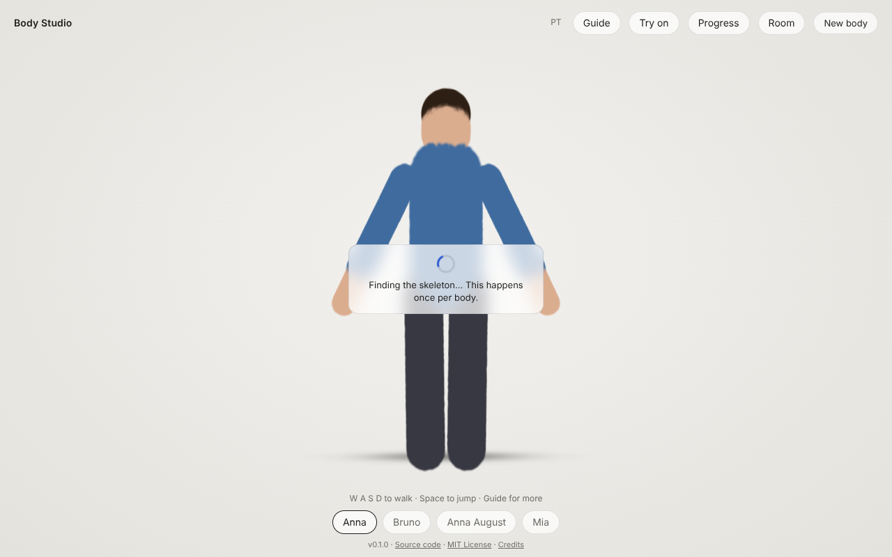

# Loading: the spinner over the body

After a body is picked there are a few steps before it can be used: the splat file is downloaded,
its skeleton is found (`GET /api/rig`, once per body, then read from `<body>.rig.json`) and the
splats are bound to it (`setup` in `static/tattoo.js`, which holds the page for a moment). Before,
the body turned on screen during all of this while posing, walking and clothes didn't answer yet,
and the only sign was a line in the Try on panel. Now a spinner over the body says what is
happening until it can be used.

## What the usual guidance says

- **By how long it takes** (Nielsen's response-time limits): under about 1 s, no indicator, since
  the user keeps their flow; from about 1 to 10 s, an indefinite indicator like a spinner; past
  about 10 s, a percent-done bar or at least a word on what is happening and why it is long.
  ([NN/g, progress indicators](https://www.nngroup.com/articles/progress-indicators/),
  [UX Tigers](https://www.uxtigers.com/post/progress-indicators))
- **Don't flash it**: wait a moment before showing a spinner (a few hundred ms), and once shown,
  keep it long enough to be seen, so a quick step neither flashes nor flickers.
  ([spin-delay](https://npmjs.com/package/spin-delay),
  [Firefox Acorn loading indicators](https://acorn.firefox.com/latest/foundations/global-patterns/loading-indicators-SKyqf3Lj))
- **Say what is loading, where it is loading**: the indicator sits on the thing that isn't ready
  yet, with a short label, rather than somewhere else on the page.
  ([Adobe XD essentials](https://blog.adobe.com/en/publish/2016/09/06/xd-essentials-best-practices-for-animated-progress-indicators))
- **One indicator**, not one per step: steps one after another read as one wait.
- **Accessible**: a `role="status"` live region for screen readers, and slower motion for people
  who asked for reduced motion.

## What the page does

`static/busy.js` (tested by `tests/js/busy.test.mjs`) keeps the steps under way and decides what
shows; `index.html` draws it and `tattoo.js` adds its steps through `bodyApp.busy(key, text)`.

| Step | Said |
|---|---|
| The splat file downloading | Loading Mia… |
| Finding the skeleton (`/api/rig`) | Finding the skeleton… This happens once per body. |
| Binding the splats to it | Getting the body ready to move… |

- Shown only after **0.4 s**, kept at least **0.6 s** once shown. The last step holds the page,
  so it shows the spinner at once (a timer couldn't fire to show it meanwhile).
- After **8 s** on one step, a second line says why ("Still working. It's only this slow the first
  time."). There is no percentage: none of these steps can tell how far along it is.
- A small card with a spinner and the line, over the middle of the body (centred between the
  panels, like the body), the cursor showing progress over the body. **Clicks and drags pass
  through**: the camera still turns, and the panel stays usable.
- The spinner is a CSS animation of `transform`, which the browser runs off the main thread, so it
  keeps turning while the page binds the splats. With reduced motion it turns slower.
- Only while there is work under way: with the Try on panel closed (as on a phone at first), the
  skeleton isn't fetched, so after the body loads nothing is shown.
